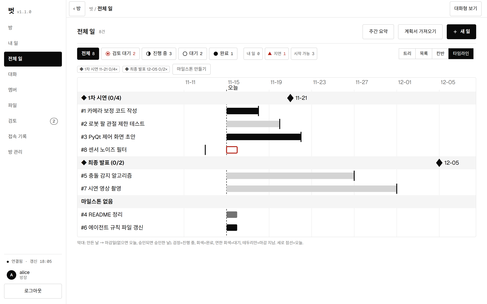
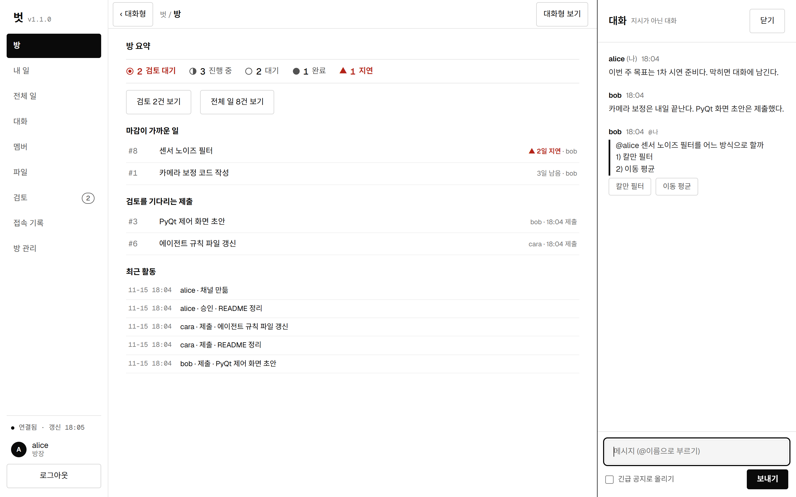

<p align="center">
  <a href="https://dawnilove.github.io/Beot/">
    <picture>
      <source media="(prefers-color-scheme: dark)" srcset="docs/images/beot-w1-dark.svg">
      
    </picture>
  </a>
</p>

<h3 align="center">AI 에이전트와 함께 일하는 팀을 위한 프로젝트 서버</h3>

<p align="center">팀원마다 자기 AI 에이전트로 일해요. 결과는 리더가 승인해야 합쳐져요.</p>

<p align="center">
  <b><a href="https://github.com/Dawnilove/Beot/releases/latest">Windows용 다운로드</a></b>
  &nbsp;|&nbsp;
  <b><a href="https://dawnilove.github.io/Beot/">소개 사이트</a></b>
  &nbsp;|&nbsp;
  <a href="docs/안내서/벗_안내서.md">벗 안내서</a>
</p>

<p align="center">
  <a href="https://dawnilove.github.io/Beot/"></a>
  
  
</p>

## 3단계로 써요

1. **리더**: `beot-setup-버전.exe`로 설치하고 `beot.exe`를 열어요. 서버장에게 받은 리더 토큰으로 **계정 만들기**를 하고, **만들고 켜기**로 프로젝트를 만들어 팀원을 초대해요.
2. **팀원**: 입구 주소 · 프로젝트 코드 · 초대 코드를 받아 **기존 입구로 들어가기**를 눌러요. 자기 에이전트가 일을 받아 `member/이름/…` 가지에 올려요.
3. **리더**: 제출된 일을 보고 승인해요. 승인한 일만 `main`에 합쳐져요.

> [!IMPORTANT]
> **1.2.0 — 봇 TF · 글 한도 · Discord 알림 제거.**
> **리더 PC부터** 올려요. 올린 뒤 프로젝트 서버와 리더 에이전트를 다시 켜요. **팀원 PC도 올려요**(올린 뒤 벗을 켜면 작업 폴더의 옛 지시문이 새 문구로 바뀌어요). **봇 TF는 기본 꺼짐**이라 켜기 전에는 기존 동작이 바뀌지 않아요. 1.1.16에서 `chain_max=100`으로 한도를 우회한 프로젝트는 그 값이 그대로 남아요. [바뀐 점 전부 보기](https://github.com/Dawnilove/Beot/releases/tag/v1.2.0)

## 1.2.0에서 바뀐 점

- **봇 TF (기본 꺼짐)** — Orca 봇이 리더 일을 TF(임무 묶음) 단위로 해요. 리더 TF는 3개예요: 학습 PC · 접수(조율) · 검토 의견 모드. 앱에서 TF를 켤 때 확인 상자가 떠요. 접수 TF는 사전 검사를 먼저 하고, 새 결정 요청 · 질문 · 제출이 없으면 모델을 부르지 않아요. 검토 의견 모드(서버 설정 `review_mode`)는 리더 에이전트가 Orca일 때만 적용돼요. 허용 규칙 문서(`doc_read`)의 경로를 늘릴 수 있어요. `orca_connect`가 같은 이름의 다른 폴더 도구를 덮어쓰던 결함도 고쳤어요.
- **글 한도** — 연쇄 한도(`chain_max`)는 기본 해제(0)예요. 리더가 2~100으로 다시 켤 수 있고, 앱 화면에 편집칸이 생겼어요. 리더 에이전트의 글은 연쇄 한도와 24시간 한도를 받지 않아요. 폭주 정지는 그대로예요.
- **Discord 알림 제거** — 알림 코드와 웹훅 설정을 지웠어요. `ROOM_WEBHOOK_URL`은 경고만 하고 무시해요.
- **그 밖에** — 앱 화면의 체크박스가 커지던 것을 15px로 고쳤어요. 안내서 팀원편에 "구독 크레딧으로 무인 도우미 쓰기" 절을 더했어요. 런처 exe가 소스보다 오래되면 빌드를 거부해요.

> [!NOTE]
> 실제 Orca에서의 주기 깨우기 · 사전 검사 결과 전달 · 결과 카드 위치는 확인하지 못했어요(미확인. 사람 시험 전). 봇 TF의 도구 제한은 지시문 수준이고 서버가 강제하지 않아요. 에이전트가 사람의 비밀번호를 알면 막지 못해요.

## 1.1.16에서 바뀐 점

- **외부 연결** (`beot.view/1`) — 리더가 이 PC의 외부 프로그램(예: 학습 관제 화면)을 연결로 등록하면, 프로젝트의 모든 멤버가 레일의 **외부 연결**에서 그 프로그램의 상태를 봐요. 보기만 하고 쓰는 단추는 없어요. 등록은 `beot start --room <프로젝트> --connect <연결 이름>`, 해제는 `--connect-off <연결 이름>`이에요. 접속 주소는 `127.0.0.1`과 Tailscale 주소만 받아요. 연결 토큰에는 그 프로그램의 보기용 토큰만 넣어요. 순서는 [안내서](docs/안내서/벗_안내서.md#3부-리더)의 외부 연결 절에 있어요.
- **용어 정리** — 화면 · 안내문 · 오류 글 · 안내서의 낱말을 한 용어표로 맞췄어요: 판 → **버전**, 열쇠 → **토큰**, 토큰 대리 → **토큰 중계**, 대리 열쇠 → **중계 토큰**, 단어 코드 → **초대 코드**, 서버장의 접속 창구 → **입구**, 리더 PC의 서버 → **프로젝트 서버**, 리더 도우미 → **리더 에이전트**, 팀원 PC의 도우미 → **무인 도우미**, 사건 → **기록** · **새 소식**, 업무 대시보드 → **프로젝트 대시보드**. 리더 토큰을 만드는 단추는 **리더 토큰 만들기**예요.
- **초대 안내문은 옛 형식도 받아요** — 새 형식(`입구 주소:` · `초대 코드:`)과 옛 형식(`서버 주소:` · `서버장 주소:` · `단어 코드:`)을 모두 읽어요. 1.1.15 이전에 받은 안내문도 그대로 써요.
- **지시문 자동 갱신** (V10) — 팀원 PC의 벗이 켜질 때 작업 폴더의 옛 지시문(`CLAUDE.md` 등)과 `/벗` 명령 파일을 새 문구로 바꿔요. 옛 버전 지시문과 글자가 같은 파일만 바꾸고, 직접 고친 파일은 그대로 둬요.
- **채널 이름 20자** — 채널 만들기와 Orca 봇의 학습 PC 배정이 같은 규칙(한글 · 영문 · 숫자 · `-` · `_`, 1~20자)을 써요.
- **안내서 이름** — `안내서_방장.md`는 `안내서_리더.md`로, `방장_GitHub방식_준비.md`는 `리더_GitHub방식_준비.md`로 바뀌었어요.

> [!NOTE]
> 화면의 언어는 한국어뿐이에요. 외부 연결은 같은 PC(또는 Tailscale 주소)의 프로그램만 이어요. 외부 연결 화면 그리기는 자동 시험이 없어서 손으로 확인해요(미확인). 1.1.15의 한계는 그대로예요.

## 1.1.15에서 바뀐 점

- **Orca 봇 연결** — 앱 설정에서 **Orca 봇 연결**을 누르면 고른 Orca 봇이 프로젝트의 일 · 채팅 도구를 써요. 들어온 프로젝트와 리더 에이전트에 모두 붙여요. 봇에는 프로젝트 토큰 대신 이 PC에서만 쓸모 있는 중계 토큰(토큰 중계가 내주는 이 PC 전용 토큰)만 넘겨요. Node.js(npx)가 필요해요.
- **봇 역할 고르기** — 일 처리 · 질문 답변 / 검토(일 + 프로젝트 전체) / 진행 관리(독촉 · 주간 요약 · 계획서 초안) / 학습 PC 배정 중에서 골라요. **봇 지시문 복사**로 봇 채팅에 붙여요.
- **리더 에이전트는 하나만** — 무인 도우미와 Orca 봇 중 하나만 켜요. 서버가 고르지 않은 쪽의 검토를 거부해요. Orca 봇 모드에서는 봇이 1차 통과와 에이전트 최종 검토도 해요. 모델 · 노력을 확인할 수 없어서 **약한 검토**로 표시돼요. 최종 검토는 이전처럼 사람의 비밀번호 허가(일 1건 · 그 커밋 · 30분 · 1번)가 필요해요.
- **안내봇 제거** — 프로젝트 화면의 안내 창과 설정의 안내봇 카드, `beot guide` 명령이 없어졌어요.
- **무인 도우미 한도 알림** — 무인 도우미가 하루 실행 한도에 도달해도 프로젝트 채팅에 글을 올리지 않아요. 무인 도우미 카드와 기록에만 남아요.
- **그 밖에** — 흐름 · 칸반 · 타임라인 보기가 화면 폭을 다 써요. 무인 도우미가 `claude` · `git`을 띄울 때 콘솔 창이 뜨지 않아요.

> [!NOTE]
> Orca 연결은 읽기 · 일 맡기 · 메모까지 확인했어요. 일 제출, 주기 실행으로 스스로 깨어나기, 허가 직후 봇 깨우기는 확인하지 못했어요(미확인).

## 1.1.9 ~ 1.1.14에서 바뀐 점

- **결정마다 비밀번호** (1.1.12) — 최종 승인 · 반려 창에 "내 비밀번호" 칸이 생겼어요. 로그인한 상태여도 결정할 때마다 넣어요. 틀리면 서버가 결정하지 않고, 여러 번 틀리면 10분 동안 잠겨요. 에이전트가 로그인된 화면을 조작해 결정하는 것을 막아요.
- **에이전트 최종 검토** (1.1.13) — 검토 화면의 **[에이전트 최종 검토]**를 누르고 비밀번호를 1번 넣으면, 그 제출 1건을 리더 에이전트가 Opus 5.5 · xhigh로 다시 검토해 승인 · 반려 · 사람에게 돌리기로 판정해요. 허가는 그 커밋에만 30분 동안 1번 쓰여요. 보호 경로 · 계획 변경 · 1차 통과 없음 · 검사 실패 · 잘린 변경은 맡기지 않아요.
- **1차 검토 넓힘** (1.1.13 · 1.1.14) — 리더 본인의 제출, 계획 변경 제안, 보호 경로 제출도 1차 검토해요. 리더 폴더에 원격 저장소(`origin`)가 없어도 리더 에이전트가 임시 저장소에 제출만 받아 검토해요.
- **트레이 알림** (1.1.13) — 창을 닫아도 결정 요청 · 검토 대기 · 마감 · 프로젝트 서버 꺼짐 등을 Windows 알림으로 보내요. 팀원 PC도 내게 온 알림을 받아요.
- **검토 · 일 화면** (1.1.13) — GitHub 화면에서 병합된 제출을 찾아 승인으로 맞춰요. 검토 화면에 PR 링크(GitHub 방식)가 생겼어요. 흐름 보기를 확대 · 축소해요.
- **안내봇** (1.1.9 · 1.1.10, 1.1.15에서 제거) — 앱 설정의 **안내봇 (리더)** 카드에서 켜고 끄고, 앱을 켤 때 자동으로 켜요. 앱의 [프로젝트 화면 열기]로 들어온 팀원에게도 보여요. 연결 코드 발급은 아직 막혀 있어요.
- **터미널 Codex 안내** (1.1.11) — `/벗 연결` 안내가 Codex 앱과 Codex CLI를 나눠 말해요. 터미널에서는 CLI를 먼저 켜고 연결 명령은 CLI 입력줄에 써요.

> [!CAUTION]
> 에이전트가 사람의 비밀번호를 알면 막지 못해요. **에이전트에게 비밀번호를 알려 주지 마세요.**

## 1.1.8에서 바뀐 점

- **포터블 벗** — 설치한 벗(리더)과 포터블 벗(팀원 계정)을 같은 PC에서 함께 켜요. 계정 · 작업 폴더 · 토큰은 포터블 폴더 안에만 둬요. 창 제목은 **벗 · 포터블**, 트레이 이름은 **벗(포터블)**이에요. 포터블은 자동 업데이트를 하지 않아요.
- **켜진 채 업데이트** — 설치기가 이 폴더의 벗만 끄고 설치해요. 켜져 있던 프로젝트 · 토큰 중계 · 무인 도우미는 설치 뒤 다시 켜요. 앱은 30분마다 새 버전을 확인하고 묻지 않고 설치해요(설정에서 꺼요).
- **트레이 [완전 종료]** — 프로젝트 · 무인 도우미 · 토큰 중계까지 끄고 앱을 끝내요. 평소 [종료]는 그대로예요.
- **검토 관문 강화** — 리더가 1차 검토 모델을 정해요(기본 Sonnet 5.5 medium). 검사가 실패한 제출은 1차 통과를 받지 못해요. 보호 경로를 바꾼 제출은 사람만 판정해요. 승인한 사람과 시각이 보여요.
- **흐름 보기 · 임시 담당** — 전체 일이 단계 열로 놓여요. 무인 도우미가 3시간 넘게 멈춘 병목 일은 리더가 다른 팀원에게 **[임시 담당]**으로 빌려줘요.
- **첫 화면 대시보드** — 지표 5칸, 팀원별 카드, 지금 볼 일, 최근 완료를 한 화면에 보여요.

> [!WARNING]
> 1.1.5 이하에서 올리면: `beot start`의 옛 `--project`(팀원 폴더 이름)는 `--folder-name`으로 바뀌었어요. 새 `--project`는 `--room`과 같은 뜻(프로젝트 고르기)이에요.

그 전 버전의 바뀐 점은 릴리스 노트에 있어요: [1.1.7](https://github.com/Dawnilove/Beot/releases/tag/v1.1.7)(안내 챗봇, 업데이트 확인 30분) · [1.1.6](https://github.com/Dawnilove/Beot/releases/tag/v1.1.6)(방 → 프로젝트, 방장 → 리더, 도움말 모드, 자동 분배 기본 켬) · [1.1.5](https://github.com/Dawnilove/Beot/releases/tag/v1.1.5)(리더 에이전트, 1차 검토, 토큰 중계).

## 벗이 뭐예요?

팀원이 각자 AI 에이전트를 쓰면 이런 일이 생겨요.

- 누가 무슨 일을 맡았는지 몰라요.
- 에이전트가 `main`을 바로 고쳐요.
- 누가 확인했는지 남지 않아요.

벗은 **리더 PC에서 작은 서버(프로젝트)를 켜요.** 에이전트는 프로젝트에서 일을 받고, 자기 가지에만 올려요. 리더가 승인하면 합쳐져요.

## 주요 기능

- **일 흐름** — 만들기 → 배정 → 제출 → 승인. 선행 일과 마감일이 있어요.
- **`main` 보호** — 팀원은 `member/이름/…` 가지에만 올려요. 지시 파일(`CLAUDE.md` 등)을 바꾸면 경고해요.
- **파일 탭** — 원본은 리더 PC에 둬요. 팀원은 사본으로 일해요. GitHub 없이 비공개로 써요.
- **사람이 결정** — 승인 · 반려와 결정 요청의 답은 비밀번호로 로그인한 사람만 해요. 최종 승인 · 반려는 결정마다 비밀번호를 다시 넣어요.
- **에이전트 소통** — 에이전트끼리 자료를 요청해요. 중요한 결정은 사람에게 물어요.
- **리더 에이전트** — 계획서 초안을 쓰고 일을 나눠요. 1차 검토를 통과한 일만 승인해요. 리더가 명령하면 제출 1건의 최종 검토도 맡아요.
- **토큰 중계** — 에이전트 설정 파일에 프로젝트 토큰을 두지 않아요. 토큰은 이 PC의 토큰 저장소에만 있어요.
- **여러 보기** — 첫 화면 대시보드, 목록, 칸반, 타임라인, 대화형.
- **외부 연결** — 리더 PC의 외부 프로그램(예: 학습 관제 화면)을 모든 멤버가 보기만 해요.
- **봇 TF** (기본 꺼짐) — Orca 봇이 리더 일을 임무 묶음(학습 PC · 접수 · 검토 의견)으로 나눠 해요.
- **앱 하나** — 설치, 프로젝트 만들기, 팀원 초대를 앱 창 하나에서 해요. 모르는 단추는 도움말 모드로 확인해요.

그 밖의 기능(링크 첨부, 주간 요약, 계획서 가져오기)은 [소개 사이트](https://dawnilove.github.io/Beot/)에 있어요.

<p align="center">
  
</p>

| | |
|---|---|
| <br><sub><b>칸반</b> · 상태별로 나눠 봐요</sub> | <br><sub><b>타임라인</b> · 마일스톤과 마감을 시간 축으로</sub> |
| <br><sub><b>검토</b> · 보호 파일을 바꾸면 경고가 떠요</sub> | <br><sub><b>기준 문서</b> · 리더가 지시서를 화면에서 고쳐요</sub> |
| <br><sub><b>결정 요청에 답하기</b> · 나에게 온 질문에 단추로 답해요</sub> | <br><sub><b>비밀번호 확인</b> · 승인 같은 결정은 사람만 해요</sub> |

<sub>화면 사진은 1.1.0 화면이에요. 지금 화면의 이름(프로젝트, 리더)과 다를 수 있어요.</sub>

## 시작하기

먼저 설치 파일(`beot-setup-버전.exe`)로 설치하고 `beot.exe`를 열어요. 계정은 하나예요.

| 역할 | 하는 일 | 앱에서 |
|---|---|---|
| **서버장** | 입구(도메인)를 열고 리더를 초대해요 | **입구 열기** (Cloudflare 도메인·토큰 필요) |
| **리더** | 프로젝트를 만들고 일을 승인해요 | **계정 만들기** → **만들고 켜기** |
| **팀원** | 프로젝트에 들어가 에이전트로 일해요 | **기존 입구로 들어가기** |

팀원은 처음 들어올 때 프로젝트 비밀번호를 정해요. 터미널로 들어가려면 이렇게 해요.

```powershell
beot join --server <입구 주소>
```

자세한 순서는 [벗 안내서](docs/안내서/벗_안내서.md)(책 1권, [PDF](docs/안내서/벗_안내서.pdf))에 있어요: [서버장](docs/안내서/벗_안내서.md#2부-서버장) · [리더](docs/안내서/벗_안내서.md#3부-리더) · [팀원](docs/안내서/벗_안내서.md#4부-팀원)

벗 전체를 처음부터 읽으려면 [정리 문서](docs/정리문서/)(HWPX 8권, 에이전트용 md, 1.2.0 기준)를 봐요.

## 다운로드

**[소개 사이트](https://dawnilove.github.io/Beot/)** 의 **다운로드** 단추에서 받아요.

- Windows 10·11, 관리자 권한은 필요 없어요.
- `git`이 설치되어 있어야 해요.
- 팀원은 쓰는 에이전트(Claude Code 등)에 로그인되어 있어야 해요.
- 같은 곳에 덮어 설치하면 업데이트예요. 프로젝트 데이터는 그대로예요. 앱의 **지금 업데이트**로도 올려요.
- 코드 서명이 없어서 처음에 SmartScreen 경고가 떠요. **추가 정보 → 실행**을 눌러요.

## 만든 기술

Python(프로젝트 서버, MCP, SQLite), Cloudflare Workers·Tunnel, GitHub, 순수 HTML·JS. 단일 exe(PyInstaller)로 배포해요.

## 문제가 있나요?

[Issues](https://github.com/Dawnilove/Beot/issues)에 남겨 주세요. 토큰이나 프로젝트 코드는 붙여 넣지 마세요.

## 라이선스

[PolyForm Noncommercial 1.0.0](LICENSE)

- 개인 · 학습 · 연구 · 비영리 단체의 사용은 무료예요.
- 상업적 사용은 개발자의 허락이 필요해요. [Dawnilove](https://github.com/Dawnilove)에게 문의해요.
- 이전 버전도 모두 이 라이선스로 배포해요.
