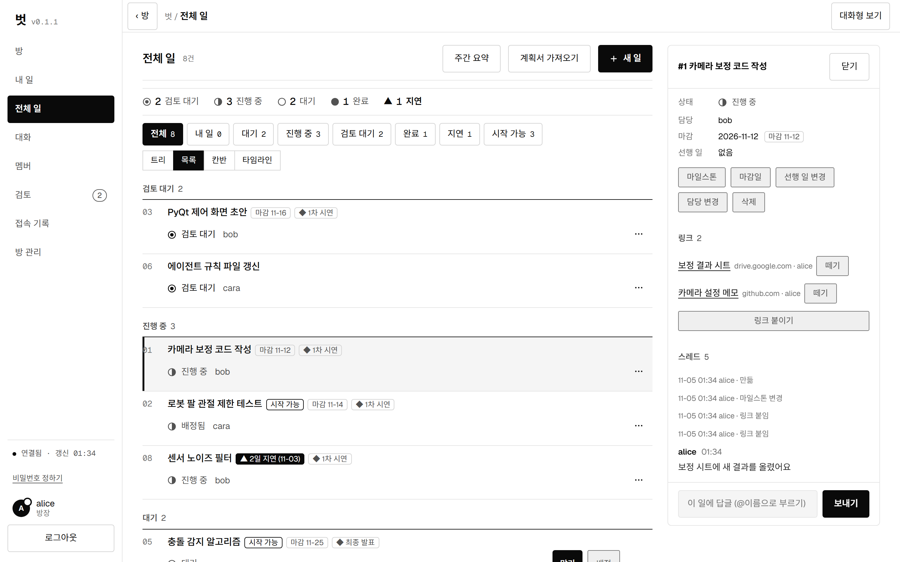
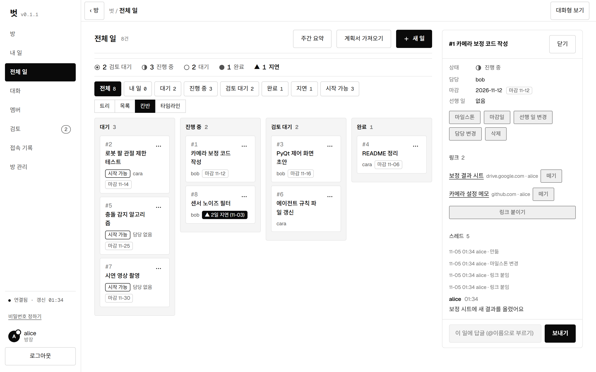
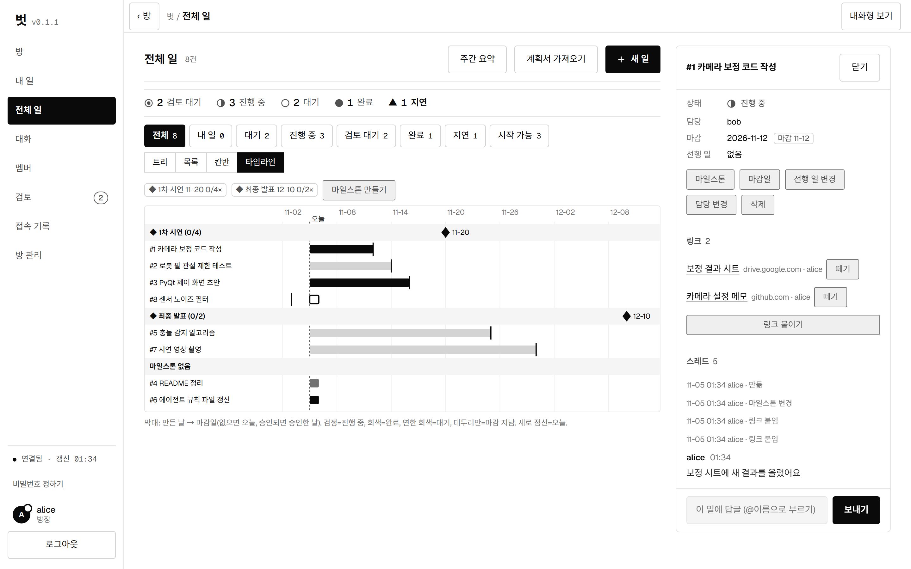
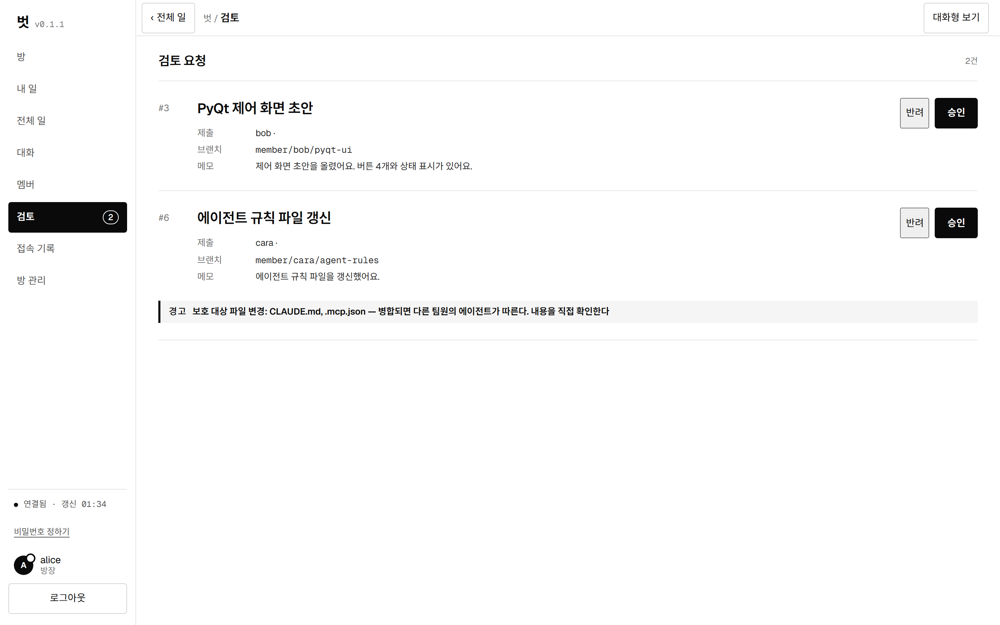
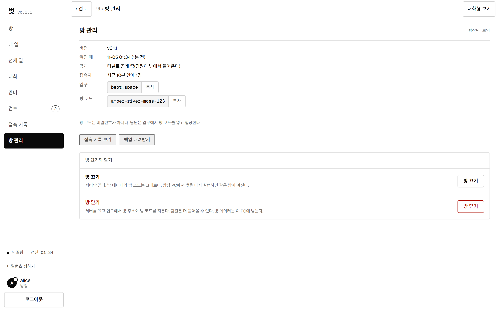

<p align="center">
  
</p>

<h3 align="center">AI 에이전트와 함께 일하는 팀을 위한 방(房)</h3>

<p align="center">
  팀원마다 자기 AI 에이전트로 일하고, 결과는 GitHub PR로 모여요.<br>
  방장이 승인해야 합쳐지니까 누가 무엇을 바꿨는지 한곳에서 볼 수 있어요.
</p>

<p align="center">
  <a href="https://github.com/Dawnilove/Beot/releases/latest"></a>
  
  
</p>

## 벗이 뭐예요?

팀 프로젝트에서 팀원 각자가 Claude Code나 Codex 같은 AI 에이전트를 쓰면 이런 문제가 생겨요.

- 누가 어떤 일을 맡았는지 모르겠어요.
- 에이전트가 `main`을 바로 고쳐서 코드가 꼬여요.
- 결과물을 누가 확인했는지 남지 않아요.

벗은 **방장 PC에서 작은 서버(방)를 켜고**, 팀원의 에이전트가 그 방에서 일을 받아 가는 도구예요. 에이전트는 방의 MCP 도구로 일을 받고, 자기 가지(branch)에만 올리고, 제출해요. **승인과 병합은 방장만** 할 수 있어요.

## 주요 기능

- **일 흐름** — 만들기 → 배정 → 맡기 → 제출 → 검토 → 승인(병합). 선행 일, 마감일, 마일스톤을 지원해요.
- **여러 가지 보기** — 목록, 트리, 칸반, 타임라인, 대화형(슬랙 같은) 보기.
- **`main` 보호** — 팀원은 `member/이름/…` 가지에만 올릴 수 있어요. 제출 뒤 가지가 바뀌면 승인이 거부돼요.
- **보호 파일 경고** — 에이전트 지시 파일(`CLAUDE.md`, `.mcp.json` 등)을 바꾼 제출은 방장이 확인했다고 밝혀야 승인돼요.
- **대화와 멘션** — 방 대화, 일마다 스레드, `@이름` 부르기, 긴급 공지.
- **링크 첨부** — 결과물(구글 드라이브, GitHub 등)의 https 주소를 일에 붙여요. 파일은 올리지 않아요.
- **주간 요약과 알림** — 지연·정체된 일을 모아 주고, Discord 웹훅으로 제출·승인을 알려요.
- **계획서 가져오기** — 마크다운 계획서를 읽어 일을 한꺼번에 만들어요.
- **방 관리 화면** — 접속자, 방 코드, 백업, 방 끄기·닫기를 한곳에서.
- **여러 에이전트** — Claude Code, Codex는 확인했고, Cursor·Gemini CLI·VS Code는 설정 파일을 만들어 줘요(`join --apps`). herdr, 마당(Madang)과도 이어져요.
- **백그라운드 실행** — 터미널을 닫아도 방은 켜져 있어요. 시계 옆 아이콘으로 끄거나 닫아요.

<p align="center">
  
</p>

| | |
|---|---|
| <br><sub><b>칸반</b> · 상태별로 나눠 봐요</sub> | <br><sub><b>타임라인</b> · 마일스톤과 마감을 시간 축으로</sub> |
| <br><sub><b>검토</b> · 보호 파일을 바꾸면 경고가 떠요</sub> | <br><sub><b>방 관리</b> · 접속자, 방 코드, 방 끄기·닫기</sub> |

## 시작하기

벗에는 세 가지 역할이 있어요.

| 역할 | 하는 일 | 처음 한 번 |
|---|---|---|
| **서버장** | 입구(도메인)를 열고 방장을 초대해요. 보통 한 명이에요 | Cloudflare 도메인과 API 토큰이 필요해요 |
| **방장** | 방을 만들고 일을 배정하고 승인해요 | 서버장에게 받은 방장 열쇠로 방을 만들어요 |
| **팀원** | 방에 들어가 에이전트로 일해요 | `join` 한 번이면 돼요 |

**팀원은** 방 코드를 받아서 이렇게 들어가요.

```powershell
beot join --server <서버장 주소>      # 방 코드와 닉네임, 비밀번호를 물어봐요
```

자세한 순서는 안내서를 보세요: [서버장](docs/안내서_서버장.md) · [방장](docs/안내서_방장.md) · [팀원](docs/안내서_팀원.md)

## 다운로드

[Releases](https://github.com/Dawnilove/Beot/releases/latest)에서 Windows용 압축 파일을 받아요. 풀고 `beot.exe`를 실행하면 돼요.

- Windows 10·11
- `git`이 설치되어 있어야 해요
- 팀원은 쓰는 에이전트(Claude Code 등)가 설치·로그인되어 있어야 해요
- 코드 서명은 하지 않아서 처음 실행할 때 SmartScreen 경고가 뜰 수 있어요. **추가 정보 → 실행**을 누르면 돼요.

## 만든 기술

Python(방 서버, MCP, SQLite), Cloudflare Workers와 Tunnel(입구와 공개 주소), GitHub(PR 흐름), 순수 HTML·JS(방 화면). 단일 exe(PyInstaller)로 배포해요.

## 문제가 있나요?

[Issues](https://github.com/Dawnilove/Beot/issues)에 남겨 주세요. 토큰이나 방 코드 같은 비밀값은 붙여 넣지 마세요.

## 라이선스

[MIT](LICENSE)
